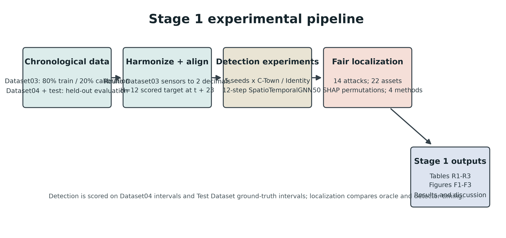
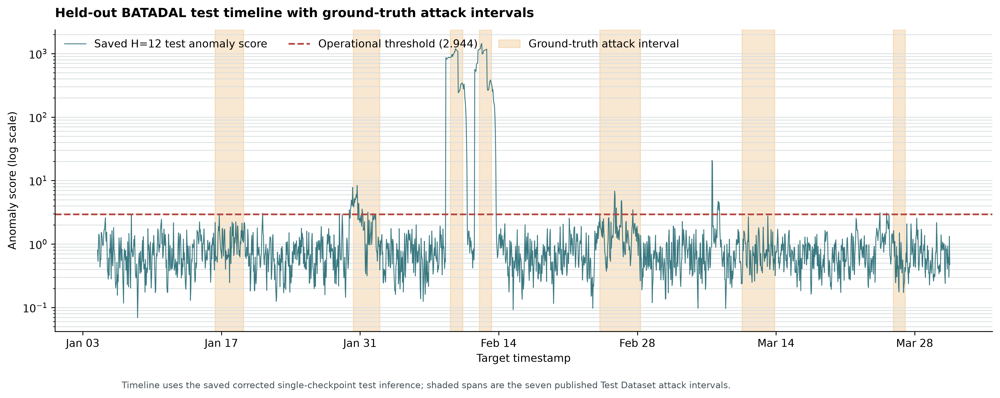
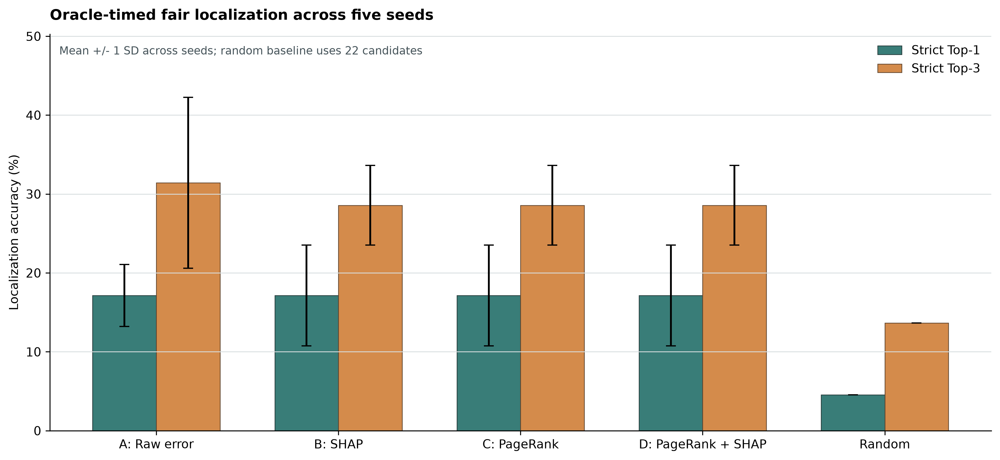

# Stage 1 Results

## Experimental setup

Dataset03 was split chronologically, with its first 80% used for model fitting and its final 20% reserved for normal-only calibration. The training sensor readings were rounded to two decimal places before imputation, scaling, or model fitting to match the precision of Dataset04 and the test data. Dataset04 and test windows were scored against their held-out labels. The H=12 input/forecast alignment uses the scored target timestamp at row offset $t + 23$ from the first input row.

Detection used a 12-step SpatioTemporalGNN (hidden dimension 64, dropout 0.2, 50 epochs, batch size 64, Adam at 0.001), with seeds 42, 123, 2024, 3407, and 9999. Each seed was trained with both the 3-hop C-Town adjacency and an identity adjacency. Normal-only calibration set the threshold to the 99.8th percentile. Test labels were sourced from **data/ground_truth_attacks.csv intervals** because the local raw test CSV does not contain an ATTACK_FLAG column; attack intervals were aligned to target timestamps using $t + 23$.

Fair localization evaluated all 14 published attack intervals with a shared set of 22 candidate assets, four methods, and 50 permutation-Shapley permutations. Oracle timing selected evidence within the known attack intervals; detector timing required the detector to flag evidence windows. Strict metrics require the exact target component, while lenient metrics count any attacked component. Values are mean +/- sample standard deviation across five seeds; random guess is the uniform candidate-ranking baseline.

The supervised SMOTE Random Forest row in R1 is a distinct Dataset04 chronological holdout experiment (836 rows); it is shown for context and is not a like-for-like comparison with the unsupervised normal-only GNN evaluation.

## Table R1: Detection

| Model / adjacency   | Evaluation split           | Runs         | F1              | recall          | precision       | ROC-AUC         | PR-AUC          | FPR             | attacks_detected |
| ------------------- | -------------------------- | ------------ | --------------- | --------------- | --------------- | --------------- | --------------- | --------------- | ---------------- |
| A_CTOWN             | Dataset04                  | 5            | 0.480 +/- 0.030 | 0.346 +/- 0.034 | 0.790 +/- 0.026 | 0.789 +/- 0.009 | 0.545 +/- 0.015 | 0.013 +/- 0.003 | 6/6/6/6/6        |
| A_CTOWN             | Test Dataset               | 5            | 0.315 +/- 0.024 | 0.211 +/- 0.020 | 0.626 +/- 0.007 | 0.737 +/- 0.006 | 0.493 +/- 0.015 | 0.031 +/- 0.002 | 6/5/5/4/5        |
| Identity            | Dataset04                  | 5            | 0.502 +/- 0.009 | 0.369 +/- 0.015 | 0.788 +/- 0.034 | 0.805 +/- 0.008 | 0.566 +/- 0.007 | 0.014 +/- 0.003 | 7/6/7/7/7        |
| Identity            | Test Dataset               | 5            | 0.333 +/- 0.015 | 0.222 +/- 0.012 | 0.669 +/- 0.023 | 0.759 +/- 0.008 | 0.534 +/- 0.013 | 0.027 +/- 0.003 | 6/6/6/6/6        |
| SMOTE Random Forest | Dataset04 temporal holdout | single model | 0.030           | 0.015           | 0.667           | 0.648           | 0.417           | 0.003           | N/A              |

## Table R2: Fair localization, oracle timing

| Method             | Strict Top-1 (%) | Strict Top-3 (%) | Lenient Top-1 (%) | Lenient Top-3 (%) | Top-3 actuator (%) | Top-3 concealment (%) |
| ------------------ | ---------------- | ---------------- | ----------------- | ----------------- | ------------------ | --------------------- |
| A: Raw error       | 17.1 +/- 3.9     | 31.4 +/- 10.8    | 24.3 +/- 6.4      | 58.6 +/- 11.7     | 30.0               | 33.3                  |
| B: SHAP            | 17.1 +/- 6.4     | 28.6 +/- 5.1     | 24.3 +/- 6.4      | 42.9 +/- 7.1      | 40.0               | 13.3                  |
| C: PageRank        | 17.1 +/- 6.4     | 28.6 +/- 5.1     | 27.1 +/- 9.3      | 47.1 +/- 9.6      | 40.0               | 13.3                  |
| D: PageRank + SHAP | 17.1 +/- 6.4     | 28.6 +/- 5.1     | 24.3 +/- 6.4      | 44.3 +/- 6.0      | 40.0               | 13.3                  |
| Random             | 4.5              | 13.6             | 9.7               | 27.1              | N/A                | N/A                   |

## Table R3: Fair localization, detector timing

| Method             | Strict Top-1 (%) | Strict Top-3 (%) | Lenient Top-1 (%) | Lenient Top-3 (%) | Top-3 actuator (%) | Top-3 concealment (%) |
| ------------------ | ---------------- | ---------------- | ----------------- | ----------------- | ------------------ | --------------------- |
| A: Raw error       | 17.1 +/- 3.9     | 30.0 +/- 7.8     | 21.4 +/- 7.1      | 47.1 +/- 10.8     | 30.0               | 30.0                  |
| B: SHAP            | 15.7 +/- 3.2     | 21.4 +/- 5.1     | 22.9 +/- 3.2      | 34.3 +/- 6.0      | 30.0               | 10.0                  |
| C: PageRank        | 15.7 +/- 3.2     | 21.4 +/- 5.1     | 24.3 +/- 3.9      | 35.7 +/- 5.1      | 30.0               | 10.0                  |
| D: PageRank + SHAP | 15.7 +/- 3.2     | 21.4 +/- 5.1     | 22.9 +/- 3.2      | 35.7 +/- 5.1      | 30.0               | 10.0                  |
| Random             | 4.5              | 13.6             | 9.7               | 27.1              | N/A                | N/A                   |

## Findings and limitations

The C-Town graph did not improve detection over identity adjacency in these five runs. Dataset04 mean F1 was 0.480 ± 0.030 for C-Town versus 0.502 ± 0.009 for identity; test mean F1 was 0.315 ± 0.024 versus 0.333 ± 0.015. These descriptive results do not establish statistical equivalence: no paired inferential test was specified. The result is consistent with the current sensor/time-series representation already carrying most useful predictive information, while fixed graph mixing may provide no additional signal (or may dilute useful channel-specific features); distinguishing those explanations requires a targeted ablation.

For oracle localization, proposed D achieved strict Top-1 17.1% and Top-3 28.6%, compared with direct-SHAP B at 17.1% and 28.6%. D and B made identical Top-3 decisions in 70/70 detected attack-seed runs in this execution (D-only 0; B-only 0). This is the observed result; it differs from the anticipated 68/70 agreement. The combined PageRank+SHAP score did not improve strict Top-3 over direct SHAP, motivating Stage 2 work on stronger, better calibrated hydraulic constraints rather than claiming a localization gain from the current graph prior.

Across the stated replication ranges, Dataset04 and test F1 are close to the approximate targets. Localization is weaker than the rough range: strict Top-1 is 17.1% (target about 21%) and proposed strict Top-3 is 28.6% (target about 30-36%). The benchmark completed, but the localization range gate is **not fully met**; these outputs should be treated as measured results, not tuned to match the expected values.

## Figures

